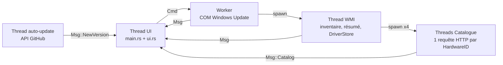

# Architecture

MesDrivers est un exécutable Rust unique et portable (~1,8 Mo), sans installation. Le code Windows (COM, WMI, SetupAPI) est derrière `#[cfg(windows)]`. Le reste (UI, logique pure, réseau) compile et se teste aussi sur macOS/Linux.

## Modules

| Fichier | Rôle |
|---|---|
| `main.rs` | État de l'app (`App`), boucle d'événements, touches, parsing des arguments CLI |
| `ui.rs` | Rendu ratatui des 5 onglets. Aucune logique métier |
| `worker.rs` | Thread de travail : reçoit des `Cmd`, renvoie des `Msg`. Scan, installation, sauvegarde, nettoyage, auto-update |
| `model.rs` | Structures (`Device`, `Update`, `Package`, `Catalog`…) et fonctions pures testées (versions, dates, filtre, regroupement, obsolescence) |
| `inventory.rs` | WMI `Win32_PnPSignedDriver` (pilotes) et `Win32_PnPEntity` (périphériques en erreur) |
| `system.rs` | WMI : résumé du PC (OS, CPU, RAM, carte mère, BIOS, GPU, disques) |
| `wu.rs` | Windows Update Agent (COM) : recherche `Type='Driver'`, installation unitaire |
| `catalog.rs` | Catalogue Microsoft Update : recherche HTML, parsing, téléchargement du .cab, vérification SHA-1 |
| `store.rs` | DriverStore : lecture des `oem*.inf` (UTF-16/UTF-8), `SetupGetInfDriverStoreLocationW` |
| `pnputil.rs` | Appels à `pnputil` et `expand` (codes retour, pas le texte qui est traduit) |
| `selfupdate.rs` | Mise à jour de l'exe depuis les releases GitHub (SHA-256) |
| `journal.rs` | Journal `%LOCALAPPDATA%\mesdrivers\journal.txt` |
| `cli.rs` | Mode sans interface : `--scan`, `--catalog`, `--catalog-get`, `--backup`, `--restore` |

## Threads

- **Les objets COM (`IUpdate`) ne sont pas `Send`** : tout Windows Update reste dans le worker, qui garde la liste de la dernière recherche. L'UI ne manipule que des index.
- **Scan :** WMI et Windows Update tournent en parallèle, donc le temps total est le maximum des deux, pas la somme. Mesuré en CI : WMI ~5 s ∥ WU ~8-10 s.
- **Catalogue :** les résultats arrivent au fil de l'eau (`Msg::Catalog(hwid, résultat)`), appliqués par HardwareID et non par index. Un rescan en cours ne peut donc pas les mélanger.
- **Fin de commande :** chaque commande se termine par `Msg::Done`. Si le worker meurt, l'UI le détecte (`Disconnected`) au lieu de rester bloquée.

## Sources de pilotes

### Windows Update
`IUpdateSearcher::Search("IsInstalled=0 and Type='Driver' and IsHidden=0")`. Windows fait lui-même le lien entre le matériel et le pilote. L'installation passe par une collection d'un seul élément à la fois, pour afficher la progression.

### Catalogue Microsoft Update (sans API officielle)
1. **Recherche :** `GET https://www.catalog.update.microsoft.com/Search.aspx?q=<HardwareID>`. Le HardwareID est essayé sans `REV_`, puis réduit à `VEN&DEV` (3 segments pour `HDAUDIO\`).
2. **Parsing :** chaque ligne est `<tr id="{guid}_R{n}">` et les cellules sont `{guid}_C{col}_R{n}` : C1 titre, C2 produits, C4 date (M/D/YYYY), C5 version. Quand la version vaut `n/a` (vieilles entrées), elle est lue en fin de titre.
3. **Choix :** seulement les produits « Windows 10 » ou « Windows 11 », puis la version maximale.
4. **Téléchargement :** `POST DownloadDialog.aspx` avec `updateIDs=[{…}]` renvoie `files[0].url` (HTTPS) et `files[0].digest` (SHA-1 en base64).
5. **Installation :** le .cab téléchargé est vérifié par son SHA-1, extrait par `expand -F:*`, et il doit contenir un `.inf` déclarant `NTamd64`/`NTarm64`. Il est ensuite installé par `pnputil /add-driver *.inf /subdirs /install`.
6. **Regroupement :** Intel publie le même paquet sous plusieurs ids (un par matériel visé). Les mises à jour sont donc regroupées par (titre, version), et un .cab déjà installé dans le lot (même empreinte) est sauté.

Seuls les périphériques `PCI\`, `USB\` et `HDAUDIO\` dont le fournisseur n'est pas Microsoft sont vérifiés.

## Sécurité

- **Admin :** manifeste `requireAdministrator` embarqué par `build.rs` (crate `embed-manifest`).
- **Point de restauration** (`Checkpoint-Computer`) avant toute installation ou restauration. S'il échoue, le worker renvoie la commande avec `skip_restore: true` (`Msg::NeedForce`) et l'UI redemande confirmation.
- **DriverStore :** un paquet est **obsolète** s'il est inutilisé ET qu'un paquet plus récent du même INF d'origine est en service. Un paquet seul (appareil débranché) n'est jamais proposé. La suppression se fait avec `pnputil /delete-driver` **sans** `/force`.
- **Fermeture :** `q` est refusé pendant une opération qui modifie le système.
- **Auto-update :** l'exe est comparé à `mesdrivers.exe.sha256` publié par la CI. L'exe en cours est renommé en `.old` (Windows l'autorise), puis la nouvelle version est écrite. En cas d'échec, l'ancienne version est remise en place.

## Codes pnputil utiles

| Code | Sens | Traitement |
|---|---|---|
| 0 | succès | OK |
| 3010 | succès, redémarrage requis | OK + « Redémarrage nécessaire » |
| 259 | ajouté au magasin, Windows garde le pilote actuel | OK (pas une erreur) |
| autre | échec | erreur + dernière ligne de la sortie |
